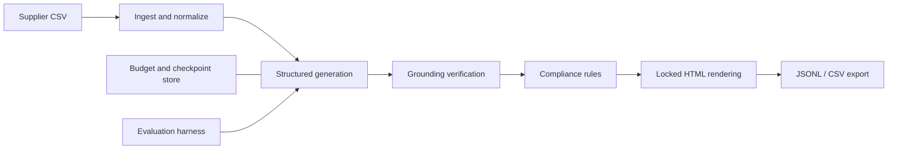

# eBay Listing LLM Pipeline

**Supplier data in, validated and source-grounded listing objects out.** A synthetic-data-only, offline-first LLM engineering portfolio project. No live eBay publishing or scraping.

[](https://github.com/DanyVX/ebay-listing-llm-pipeline/actions/workflows/ci.yml)


## Demo

CLI screenshots/GIF: TBD (not yet recorded). The offline example below is implemented and exercised in CI.

## Key results

| Metric | Result |
|---|---|
| Schema-valid listings | TBD (not yet measured) |
| Grounding precision | TBD (not yet measured) |
| Policy-rule pass rate | TBD (not yet measured) |
| Cost per valid listing | TBD (not yet measured) |
| Latency p50 / p95 | TBD (not yet measured) |

## Why this exists

Test engineering practices for grounded, structured LLM output: deterministic checks, versioned prompts, resumable runs, auditable cost controls, and measured model comparisons. **This repository is independent of ListJet**. Only synthetic examples are allowed; do not add real supplier, seller, inventory, customer, or proprietary data.

## Architecture



M1-M9 modules have implementations, but this is still an **offline research prototype** pending complete acceptance and real-model evaluation.

## Quickstart

Requires Python 3.11+ and internet access for installing dependencies. Tested locally only with Python 3.13.5 and preinstalled libraries; fresh-clone installation and CI are not yet verified.

```bash
python -m pip install -e ".[dev]"
python -m elp policy-check
python -m elp budget-check
python -m pytest
```

For a cross-platform task runner: `python scripts/tasks.py test-fast`.
The `uv` workflow is recommended where internet access is available: `uv sync --extra dev`. A resolved `uv.lock` is not yet committed because the current sandbox cannot reach the registry.

## Usage

- `python -m elp policy-check --path configs/rules.yaml`: validate policy metadata and types.
- `python -m elp budget-check`: inspect configured run/day caps without making API calls.
- `python -m elp environment`: local runtime details without revealing credentials.

M1 ingest is available now:\n\n```bash\npython -m elp ingest data/sample/synthetic.csv --output output/normalized.jsonl --rejects output/rejects.csv\n```\n\nRun the offline baseline and export it (does not call any LLM or eBay API):

```bash
python -m elp run output/normalized.jsonl --output output/listings.jsonl
python -m elp validate output/listings.jsonl
python -m elp export output/listings.jsonl --output output/export.csv
python -m elp eval --sample 100 --output results/offline.json
```

Use `python -m elp policy-check` and `python -m elp costs` to inspect rules and budget.

## Configuration

Copy `.env.example` to an untracked `.env`. **Both cost caps default to $0 USD**. API calls cannot be enabled without explicitly increasing the limits. `configs/rules.yaml` contains a *small verified policy subset* and explicitly unverified market-specific values; do not mistake these for exhaustive compliance. `configs/models.yaml` includes only a synthetic fixture adapter.

## Reproduce benchmarks

Run `python -m eval.benchmark --sample 100 --output results/offline.json`. The JSON includes measured elapsed seconds, counts, package versions, git hash and hardware details. The deterministic baseline is NOT a model benchmark and cannot satisfy a three-model comparison.

## Design decisions

See [Design and decision log](docs/DESIGN.md) and [policy evidence](configs/rules.yaml).

## Limitations

M1-M9 provide an offline prototype, NOT a production listing system. Real-model validation, three-provider comparisons, human annotation, official item-specific taxonomy lookups, vendor permissions, a complete clean-clone audit and release verification remain outstanding. See [Limitations](docs/LIMITATIONS.md).

## Roadmap

Implemented prototype: M0-M9. Pending: strengthen edge-case and property tests, verified marketplace taxonomy limits, human labels and 3-model evaluation, provider integration, provenance audit, clean-clone verification, demo, release tag.

## License

MIT. See [LICENSE](LICENSE).

## Acknowledgements and citations

Official eBay documentation is linked per verified rule in `configs/rules.yaml`. This project is not endorsed by eBay.
