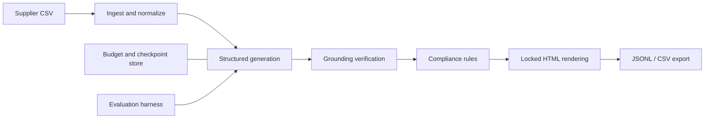

# eBay Listing LLM Pipeline

**Supplier data in, validated and source-grounded listing objects out.** A synthetic-data-only, offline-first LLM engineering portfolio project. No live eBay publishing or scraping.

[](https://github.com/DanyVX/ebay-listing-llm-pipeline/actions/workflows/ci.yml)


## Demo

TBD (not yet implemented). No GIF or screenshot is claimed.

## Key results

| Metric | Result |
|---|---|
| Schema-valid listings | TBD (not yet measured) |
| Grounding precision | TBD (not yet measured) |
| Policy-rule pass rate | TBD (not yet measured) |
| Cost per valid listing | TBD (not yet measured) |
| Latency p50 / p95 | TBD (not yet measured) |

## Why this exists

Test engineering practices for grounded, structured LLM output: deterministic checks, versioned prompts, resumable runs, auditable cost controls, and measured model comparisons. **This repository is independent of ListJet**. Only synthetic examples are allowed; do not add real supplier, seller, inventory, customer, or proprietary data.

## Architecture



Modules beyond the M0 foundation are **planned, not implemented yet**.

## Quickstart

Requires Python 3.11+ and internet access for installing dependencies. Tested locally only with Python 3.13.5 and preinstalled libraries; fresh-clone installation and CI are not yet verified.

```bash
python -m pip install -e ".[dev]"
python -m elp policy-check
python -m elp budget-check
python -m pytest
```

For a cross-platform task runner: `python scripts/tasks.py test-fast`.
The `uv` workflow is recommended where internet access is available: `uv sync --extra dev`. A resolved `uv.lock` is not yet committed because the current sandbox cannot reach the registry.

## Usage

- `python -m elp policy-check --path configs/rules.yaml`: validate policy metadata and types.
- `python -m elp budget-check`: inspect configured run/day caps without making API calls.
- `python -m elp environment`: local runtime details without revealing credentials.

M1 ingest is available now:\n\n```bash\npython -m elp ingest data/sample/synthetic.csv --output output/normalized.jsonl --rejects output/rejects.csv\n```\n\nListing generation, exports, and benchmark commands are coming in later milestones.

## Configuration

Copy `.env.example` to an untracked `.env`. **Both cost caps default to $0 USD**. API calls cannot be enabled without explicitly increasing the limits. `configs/rules.yaml` contains a *small verified policy subset* and explicitly unverified market-specific values; do not mistake these for exhaustive compliance. `configs/models.yaml` includes only a synthetic fixture adapter.

## Reproduce benchmarks

TBD (not yet measured). The eventual `bench/` and `eval/` commands will emit `results/*.json` with hardware and git SHA and render results without manually edited numbers.

## Design decisions

See [Design and decision log](docs/DESIGN.md) and [policy evidence](configs/rules.yaml).

## Limitations

This is an M0 scaffold, not a production listing generator. No model benchmark, eBay API integration, license clearance for future models, human evaluation, or policy/legal clearance is claimed. See [Limitations](docs/LIMITATIONS.md).

## Roadmap

M0 foundation, policy config, budgets; M1 ingest; M2 schema generation; M3 injection; M4 rules; M5 grounding; M6 rendering; M7 batch checkpoints; M8 evaluation; M9 CLI/export/release.

## License

MIT. See [LICENSE](LICENSE).

## Acknowledgements and citations

Official eBay documentation is linked per verified rule in `configs/rules.yaml`. This project is not endorsed by eBay.
